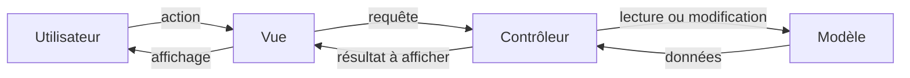
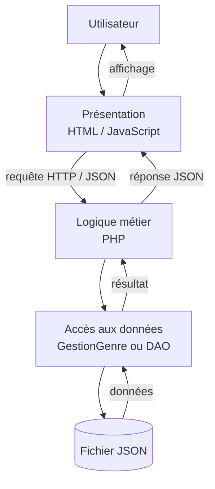
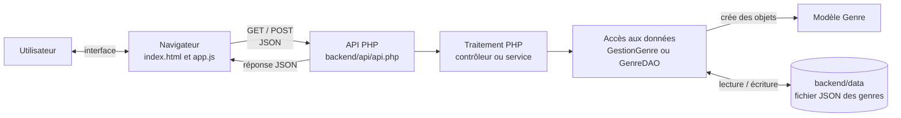

```mermaid
classDiagram
    direction TB

    class Tutor {
        -int id
        -string firstName
        -string lastName
        -string email
        -string phone
        -string bio
        +getFullName() string
        +getCourses() List~Course~
    }

    class SchoolSubject {
        -int id
        -string name
        -string description
        -datetime createdAt
        -datetime updatedAt
        +getCourses() List~Course~
        +toArray() array
    }

    class Course {
        -int id
        -string title
        -string slug
        -string description
        -int tutorId
        -int subjectId
        -string status
        -datetime createdAt
        -datetime updatedAt
        +getTutor() Tutor
        +getSubject() SchoolSubject
        +getEnrolledStudents() List~Student~
        +publish() void
        +draft() void
        +toArray() array
    }

    class Student {
        -int id
        -string firstName
        -string lastName
        -string email
        -string studentNumber
        -datetime registeredAt
        +getFullName() string
        +getEnrolledCourses() List~Course~
        +enrollInCourse(courseId) bool
    }

    class Enrollment {
        -int id
        -int studentId
        -int courseId
        -datetime enrolledAt
        -string progressStatus
        -float grade
        +getStudent() Student
        +getCourse() Course
    }

    Tutor "1" --> "0..*" Course : enseigne / dispense
    SchoolSubject "1" --> "0..*" Course : catégorise

    Student "1" --> "0..*" Enrollment : effectue
    Course "1" --> "0..*" Enrollment : enregistre
    Student "0..*" .. "0..*" Course : s'inscrit à
```

# Rapport de Projet : Blog des Lauréats

> Document consolidé à partir des chapitres modulaires.

> Date de génération : 2026-11-19

---

# Remerciement

---

# Chapitre 1 : Introduction

---

# Contexte du projet

---

# Cahier des charges

---

# Méthodologie de travail

---

# Méthode de travail

## La méthode SCRUM

La méthodologie Scrum est une méthodologie agile qui permet de gérer un projet de manière flexible et collaborative, en favorisant la livraison progressive de fonctionnalités. Elle repose sur l'itération, la priorisation des tâches et la communication régulière entre les membres de l'équipe. Dans le cadre de ce projet Promatch, nous avons organisé le travail selon les principes de Scrum, ce qui nous a permis de mieux planifier, suivre et livrer les différentes fonctionnalités de manière efficace.

*Figure 3 : La méthode SCRUM*

**Principe Scrum :**

- **Transparence** : visibilité complète sur les tâches, les objectifs et l'avancement du projet pour toute l'équipe.
- **Inspection** : évaluation régulière à la fin de chaque sprint afin d'identifier les erreurs, les blocages et les axes d'amélioration.
- **Adaptation** : ajustement du plan de travail en fonction des retours et des résultats obtenus lors des sprints.

**Organisation du projet en sprints :**

### Sprint 1

-

### Sprint 2 :

-

---

# Design thinking

Ainsi, l’adoption de la méthode Scrum a permis d’assurer une organisation efficace du travail et une meilleure gestion du projet. Elle a contribué à améliorer la qualité des fonctionnalités développées et à garantir un déroulement structuré du projet ImmoSync.

## Design thinking

Le Design Thinking est une approche de résolution de problèmes centrée sur l’humain. Elle vise à comprendre en profondeur les besoins réels des utilisateurs afin de concevoir des solutions innovantes, utiles et adaptées. Cette méthode est largement utilisée dans les domaines du design, de la technologie, de l’éducation et de l’innovation pour répondre à des problématiques complexes.

*Figure : Méthodologie Design Thinking*

Le Design Thinking est particulièrement utilisé pour :

- Encourager la créativité et l’innovation dans la conception de solutions ;
- Proposer des réponses réellement adaptées aux besoins des utilisateurs ;
- Favoriser la collaboration entre différentes équipes de travail ;
- Résoudre des problèmes complexes ou mal définis de manière structurée.

## Les étapes du Design Thinking

Le processus du Design Thinking se compose de plusieurs étapes essentielles :

- **Empathie (Empathize)** : cette étape consiste à comprendre l’utilisateur en l’observant, en l’interrogeant et en analysant son comportement. L’objectif est d’identifier ses besoins, ses attentes et ses difficultés réelles.
- **Définition du problème (Define)** : elle permet de regrouper les informations collectées afin de formuler un problème clair et centré sur l’utilisateur, souvent exprimé sous forme de question comme : « Comment pourrions-nous améliorer… ? »
- **Idéation (Ideate)** : cette phase consiste à générer un maximum d’idées possibles sans jugement, en utilisant des techniques comme le brainstorming ou le mind mapping afin de stimuler la créativité.
- **Prototype** : elle consiste à créer une version simplifiée de la solution proposée (maquette, interface ou modèle) afin de tester rapidement les idées.
- **Test** : cette dernière étape permet de tester le prototype auprès des utilisateurs, de recueillir leurs retours et d’améliorer la solution en fonction des résultats obtenus.

Le Design Thinking est donc une méthode structurée et flexible qui permet de transformer une idée en solution concrète en mettant toujours l’utilisateur au centre du processus.

---

# Planification

---

# Branche fonctionnelle

---

# Carte d'empathie

---

# Définition du problème

---

# Idéation

---

# Diagramme de cas d'utilisation

---

# Stack technologique

---

# Architecture du système

## Architecture MVC

Le modèle MVC répartit une application en trois rôles :

- **Modèle** : représente les données et les règles qui leur sont liées.
- **Vue** : affiche les informations et reçoit les actions de l’utilisateur.
- **Contrôleur** : reçoit une action, sollicite le modèle et transmet le résultat à la vue.

_Figure 1 — Échange MVC : le contrôleur coordonne la vue et le modèle lors d’une requête._

Dans le projet, MVC sert de **repère de compréhension**, mais n’est pas appliqué strictement : l’interface HTML/JavaScript est côté navigateur, tandis que le point d’entrée PHP et les classes de traitement jouent les rôles de coordination. La classe `Genre` représente les données métier.

## Architecture 3-tiers

Cette architecture sépare l’application en couches qui communiquent de proche en proche :

- **Présentation** : interface HTML/JavaScript ; envoie les requêtes et affiche les réponses.
- **Logique métier** : traite les opérations demandées par l’utilisateur.
- **Accès aux données** : lit et écrit les données dans leur support de stockage.

_Figure 2 — Les trois tiers séparent l’interface, le traitement des opérations et le stockage._

## Architecture globale

Le projet permet de consulter et d’ajouter des genres. L’interface du navigateur communique avec une API PHP via `fetch`. Les données sont conservées dans un fichier JSON ; elles ne sont pas stockées dans une base de données relationnelle.

_Figure 3 — Architecture commune aux versions du projet ; les noms des classes varient selon la version._

Le parcours d’une requête est le suivant :

1. `app.js` envoie une requête **GET** pour afficher les genres ou **POST** pour en ajouter un.
2. `api.php` transmet l’opération au traitement PHP, puis à la classe qui lit ou met à jour le fichier JSON.
3. Le résultat est renvoyé au navigateur au format JSON ; l’interface affiche la liste actualisée.

---

# Prototype (fonctionnalités, classes)

---

# Conception

---

---

# Maquettes

---

# Réalisation

---

# Interfaces

---

# Chapitre 2 : Conclusion

---

